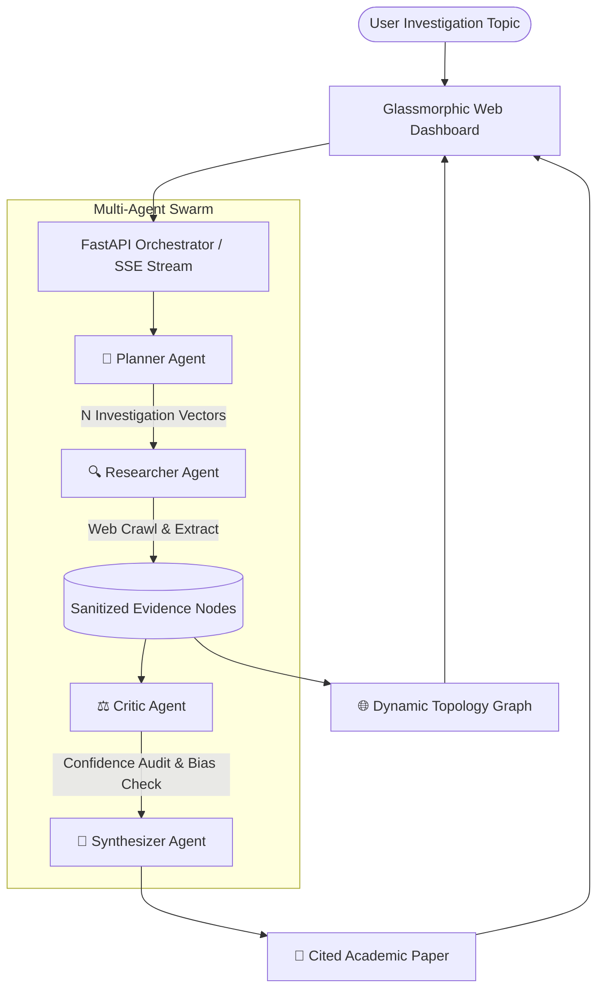

# 🧠 DeepResearch Swarm: Autonomous Multi-Agent Academic Research Engine

[](https://python.org)
[](https://fastapi.tiangolo.com)
[-brightgreen.svg?style=flat&logo=pytest&logoColor=white)](tests/)
[](agents/)
[](LICENSE)
[](#author)

> An end-to-end distributed multi-agent research swarm engineered from scratch in Python and FastAPI. The engine decomposes complex technical queries, crawls live web sources, cross-checks claims via a peer-review Critic Agent, and synthesizes publication-grade, citation-backed academic reports in real time.

---

## 🌟 Engineering Highlights & Features

Unlike basic single-prompt scripts, **DeepResearch Swarm** is built with modular agent abstraction and real-time streaming architectures:

- **🎯 Planner Agent**: Automatically decomposes research topics into 2, 4, or 6 investigative vectors based on configured depth (Architecture, Benchmarks, Vulnerabilities, Future Roadmap).
- **🔍 Researcher Agent**: Crawls live web search results, parses DOM structures, and sanitizes unstructured text nodes.
- **⚖️ Critic / Fact-Checker Agent**: Evaluates gathered evidence for credibility, cross-examines conflicting technical claims, and computes an objective **Fact-Check Confidence Score (0-100%)**.
- **📝 Synthesizer Agent**: Structures findings into an academic paper with inline citations `[1]`, `[2]`, comparative markdown tables, and a formal bibliography.
- **🌐 Dynamic Investigation Topology Graph**: Interactive visual SVG network rendering the topic node expanding into investigation vectors and discovered evidence nodes in real-time.
- **📊 Live Metrics HUD**: Displays live counters for vectors explored, evidence nodes crawled, fact-check rating, and sub-second pipeline latency.
- **⚡ Real-Time Streaming (SSE)**: Asynchronous Server-Sent Events stream live agent status directly to the glassmorphic dashboard.
- **📄 Multi-Format Academic Export**: 1-click export to Markdown (`.md`), standalone formatted HTML (`.html`) for PDF printing, or clipboard copying.
- **🛡️ Zero-Fail Resilience**: Fully operational out-of-the-box with or without an active API key through deterministic heuristic modeling.

---

## 🏗️ System Architecture



---

## 📂 Project Structure

```text
deep-research-engine/
├── .github/
│   └── workflows/
│       └── ci.yml             # Automated CI pipeline running pytest on PRs
├── agents/
│   ├── __init__.py
│   ├── planner.py             # Formulates search queries & research angles
│   ├── researcher.py          # Web search executor & DOM content extractor
│   ├── critic.py              # Fact-checking auditor & confidence scorer
│   ├── synthesizer.py         # Academic paper synthesis & bibliography generator
│   └── orchestrator.py        # Coordinates agent lifecycle with SSE event streaming
├── core/
│   ├── __init__.py
│   ├── llm_client.py          # LLM client interface with heuristic fallback
│   └── search_tools.py        # Live web crawling & extraction utilities
├── templates/
│   └── index.html             # Glassmorphic UI with dynamic SVG graph & HUD
├── tests/
│   ├── test_agents.py         # Agent pipeline unit tests
│   └── test_api.py            # API endpoint integration tests
├── app.py                     # FastAPI application entrypoint
├── requirements.txt           # Production dependencies
├── LICENSE                    # MIT License
└── README.md
```

---

## 🚀 Quick Start Guide

### 1. Clone & Set Up Environment

```bash
git clone https://github.com/soumyadeepmagnusx/deep-research-engine.git
cd deep-research-engine

# Create virtual environment
python -m venv .venv

# Activate virtual environment
# Windows:
.venv\Scripts\activate
# Linux / macOS:
source .venv/bin/activate

# Install dependencies
pip install -r requirements.txt
```

### 2. Configure Environment (Optional)

```bash
# Windows PowerShell:
$env:GEMINI_API_KEY="your-api-key"

# Linux / macOS:
export GEMINI_API_KEY="your-api-key"
```
*(If no key is configured, the system gracefully runs in heuristic simulation mode for offline demonstration).*

### 3. Launch the Server

```bash
python app.py
```
Open your browser at **`http://localhost:8000`** to interact with the dashboard!

### 4. Run Automated Test Suite

```bash
python -m pytest tests/ -v
```

---

## 🌐 Free Cloud Deployment

### Option A: Deploy on Render (Recommended)
1. Push your repository to GitHub.
2. Sign in to [Render](https://render.com) and click **New Web Service**.
3. Select your `deep-research-engine` repository.
4. Settings:
   - **Environment**: `Python 3`
   - **Build Command**: `pip install -r requirements.txt`
   - **Start Command**: `uvicorn app:app --host 0.0.0.0 --port $PORT`
5. Click **Deploy Web Service** — you get a public live URL to showcase on your resume and LinkedIn!

### Option B: Deploy on Railway
1. Sign in to [Railway](https://railway.app).
2. Click **New Project** -> **Deploy from GitHub repo**.
3. Railway automatically recognizes the FastAPI server and provisions a live URL.

---

## 👨‍💻 Author

**Soumyadeep Ghosh** ([@soumyadeepmagnusx](https://github.com/soumyadeepmagnusx))  
*B.Tech in Computer Science & Engineering*  
Focus: Distributed Systems, Autonomous Agent Architecture, Full-Stack Engineering.

---

## 📜 License
Released under the [MIT License](LICENSE).
